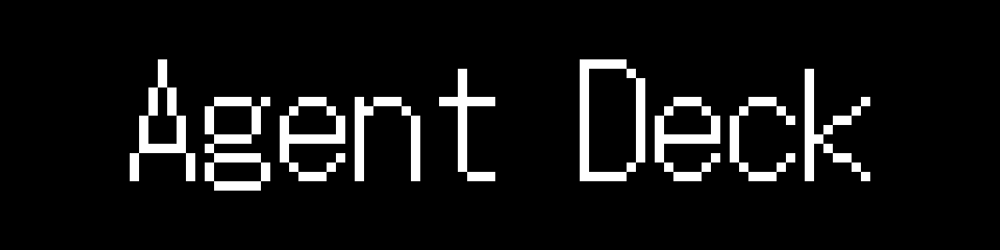
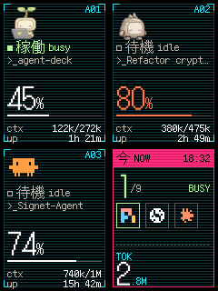

A desk display for Claude Code, pi and Codex sessions running on a Mac. The
Mac sends session data over USB to an ESP32, which draws it on a 2.8"
240x320 ILI9341 SPI TFT LCD.

The deck shows each session's agent, name, busy/idle status, uptime, context
window usage and, for Claude Code, running subagents. Busy sessions appear
first, then idle sessions, newest first within each group. Claude Code uses
an animated mascot tinted with the session's `/color`; pi and Codex sessions
show random OpenAI pets.

## Preview

<p align="center">
  
</p>

## How it works

```text
Mac                                                  ESP32
───                                                  ─────
deck host ── finds sessions ─┐
                              ▼
link-lib  Encoder ── frame ── USB serial ──▶ link-lib Decoder
                                                     │
                                                     ▼
                                             deck (Deck scene) ──▶ LCD
```

Every poll, the Mac sends the complete session list as one frame. The deck
keeps the last intact frame, so a lost or damaged one only delays an update.

## Crates

| Crate | Runs on | Purpose |
| ----- | ------- | ------- |
| [`link-lib`](link-lib/) | Mac and ESP32 (`no_std`) | Wire format, `Encoder` and `Decoder`. |
| [`deck`](deck/) | ESP32 and Mac | `Deck` display scene, `host` session sender (`agent-deck`) and desktop preview. |
| [`firmware`](firmware/) | ESP32 | Reads USB frames and draws them with `Deck`; built separately outside the workspace. |

Outside the workspace, `tools/assets` renders fonts, logos, OpenAI's pets and
the banner into bitmaps; see [`deck`](deck/#assets). `deck` uses
[`frames`](https://github.com/ocdbytes/esp32-libs), which runs the same scene
on the panel and desktop.

## Flash the deck

OpenAI's pets are not in git, so after cloning, download them once (needs
network access; see [`deck`](deck/#assets)):

```sh
cargo run --manifest-path tools/assets/Cargo.toml
```

Wire the LCD and two buttons as described in [`firmware`](firmware/#wiring),
plug the ESP32 into the Mac, then run from this directory:

```sh
scripts/flash.sh                          # pick the port when asked
scripts/flash.sh /dev/cu.usbserial-0001   # or name it
```

This builds and flashes the firmware with `espflash`, then starts
`agent-deck`, which sends this Mac's sessions to the deck every second until
Ctrl-C. After pulling changes to the frame format, run `scripts/flash.sh`
once so the host and firmware still match. Otherwise, restart it without
flashing with:

```sh
cargo run -p deck --features host --bin agent-deck [-- PORT]
```

Install the ESP32 toolchain (`espup`, `espflash`) first; see the
[esp32-libs setup chapter](https://github.com/ocdbytes/esp32-libs/tree/main/rust-esp32-book).

## Desktop preview

Preview sessions running on this Mac in a desktop window; use ← and → to
change pages:

```sh
cargo run -p deck --example preview --features sim
```

The preview builds SDL2 from source and requires CMake.
`.cargo/config.toml` sets `CMAKE_POLICY_VERSION_MINIMUM` so CMake 4 accepts
SDL2's build files.

## Checks

```sh
cargo fmt --check
cargo clippy --workspace --all-features --all-targets -- -D warnings
RUSTDOCFLAGS='-D warnings' cargo doc --no-deps --workspace --all-features
cargo +1.85 check --workspace --all-features          # minimum Rust version
cargo +esp check -p deck -p link-lib \
  --target xtensa-esp32-none-elf -Zbuild-std=core     # ESP32 build
```

The ESP32 check requires the `esp` toolchain described in the
[esp32-libs setup chapter](https://github.com/ocdbytes/esp32-libs/tree/main/rust-esp32-book).

## Requirements

- Rust 1.85 or newer.
- macOS or Linux on the host; the `host` feature uses `ps` and `lsof`.
- An ESP32, a 2.8" 240x320 ILI9341 SPI TFT and two 4-pin push buttons.

## License

[MIT](LICENSE)
